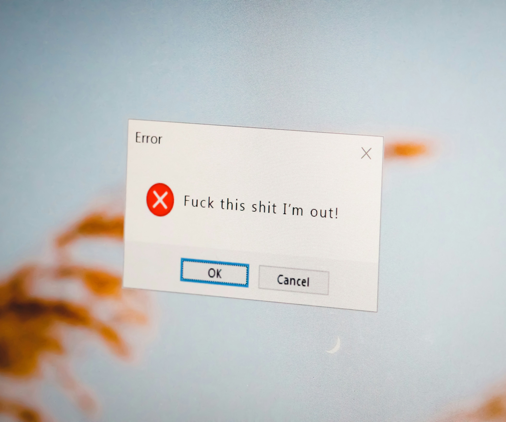
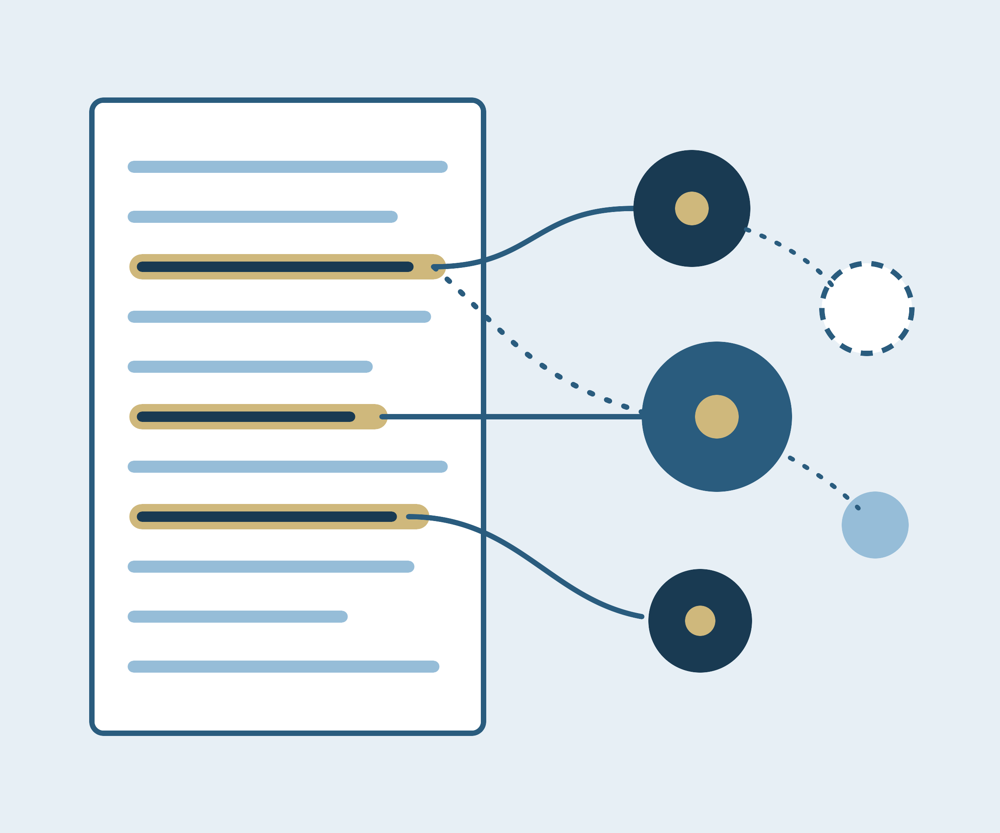

<strong>CURRENT STYLES (test page)</strong> &nbsp;|&nbsp; <a href="/project-test/">Current styles</a> &nbsp;|&nbsp; <a href="/project-test-proposed/">Proposed (Dusk Blue palette)</a>

Many people have more online accounts than they can easily manage. The average internet user maintains over 100 accounts across social media platforms, email providers, cloud storage services, and other digital services. However, users, despite knowing they have many accounts, tend to underestimate how many abandoned accounts they have. Additionally, many users have little idea what options are actually available to them when they aim to leave a platform, remove their data, or plan for what happens to their accounts after they die. Users' digital footprints grow larger and more complex to manage over time.

The account closure project spans two threads of research. First, an investigation of the process by which people chose to abandon or delete their social media accounts, and the factors influencing their end-choice. Our research in this thread comprises the development of a model for account closure.

Building from the account closure model, the second thread of research then aims to build up tools to support people in closing their accounts. Account closure is often a time intensive and frustrating process, and by understanding what users value in the closure process, we can help streamline that process and provide recommendations to future designers.

### Researchers
[Camille Butera](https://camillebutera.com/), [Joseph J. Trybala III](https://josephtry.github.io/), [Jack Manning](https://jackmanning.me/), [Jed Brubaker](https://www.jedbrubaker.com/)

### Publications



### Project tiles (hover to see the overlay)

<ul class="gallery large-block-grid-3 medium-block-grid-3 seperated small-block-grid-1">
<li><a href='/project/account-closure/'>

</a><h4>Account Closure</h4></li>
<li><a href='/project/digital-legacy-clinic/'>

</a><h4>Digital Legacy Clinic</h4></li>
<li><a href='/project/human-ai-qual/'>

</a><h4>Human-AI Collaboration for Qualitative Analysis</h4></li>
</ul>

